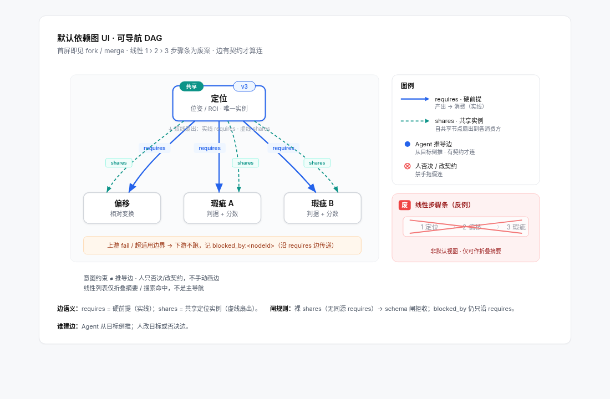
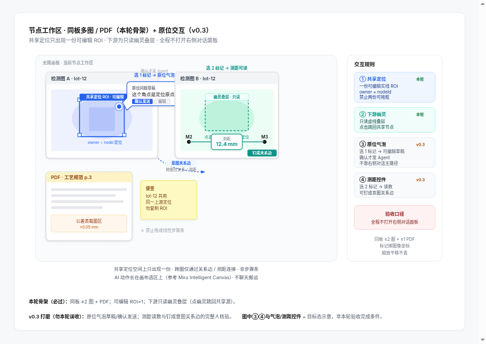

# AgentCV 产品需求文档（PRD）v0.2

| 字段 | 内容 |
|------|------|
| 产品 | AgentCV · Agent 驱动的视觉检测协作平台 |
| 版本 | **v0.2**（相对 v0.1 的结构性重构） |
| 状态 | 群共识锁定稿 · 可供工程拆分与验收 |
| 日期 | 2026-10-27（Asia/Shanghai） |
| 语言 | 简体中文（群共识用语） |
| 文档边界 | 本轮只定产品契约与验收；**不写代码、不调 Codex、不改产品实现** |
| 示意图 | `figs/fig1-dependency-dag.*` · `figs/fig2-node-workspace.*` |

---

## 0. 阅读路线与相对 v0.1 的变更说明

### 0.1 建议阅读顺序

1. **产品核心与原则**（为何存在）  
2. **从资料开始**（输入是什么）  
3. **依赖图模型** + Fig1（默认 UI 与图执行）  
4. **画板与节点工作区** + Fig2（人如何在板上核验）  
5. **解释契约与 schema 闸**（Agent 输出如何入图）  
6. **工程与版本**（Tauri / AgentRuntime / **AgentOps** / Git）  
7. **验收表**（含 Agent 原生 G1–G3 · 无界面路径 · 可勾选、可测）  
8. **待确认 / 非目标** · **附录**

### 0.2 v0.1 → v0.2：明确废弃项

| v0.1 概念 | v0.2 处置 |
|-----------|-----------|
| 左侧线性导航 / 七步流程条（1 › 2 › 3 …） | **废案**。不得作为默认产品 UI，也不得作为方案推荐形态。仅允许在文档中作为反例出现（见 Fig1 红色「废」标注）。 |
| 「先走完固定阶段再进依赖图」 | 废案。**默认首屏即为依赖 DAG**。列表折叠仅为次级视图。 |
| 右侧常驻对话面板作为主操作路径 | 废案。对话面板默认收起；**核心流程须可全程不打开右侧对话**完成。 |
| Electron 桌面壳 | 废案。桌面壳锁定为 **Tauri only**。 |
| 把具体 Agent 品牌写进对象模型 | 废案。对象模型只认抽象 **`AgentRuntime`**；品牌名仅出现在「现状」小节。 |

### 0.2.1 勘误（2026-10-27）

- **边语义（依赖图/CV/产品已锁方案 B）**：删「软扇出」；`shares` = **共享实例扇出**。凡 `shares` 消费方必须同时存在**同源** `requires`，否则 schema 闸拒收（裸 `shares` 不入库）。`blocked_by` **只沿 `requires` 传**。不采用方案 A（沿 shares 传播）。  
- **§8.1 调度**：改为「**等用户确认后再调度**」；本 PRD 不预支仓库策略，也不把「已授权开工」写进待确认默认。  
- **Agent 原生（已锁，收进主验收）**：实质操作不依赖图形界面、不需要点鼠标。`AgentOps`/CLI 与 UI 消费同一对象模型；G1–G3 与无界面夹具见 §7.7–§7.9，**不得只躺在 addendum**。第 4 章范围钉死见 §4.0。

### 0.3 v0.2 锁定方向（一句话）

> 工程师在画板上表达意图（图像 + 标记 + 关系）；Agent 反推前提、提议方案、跑试验；人在同一块板上核验。默认 UI 是**意图画布 + 依赖 DAG**，不是线性步骤。**Agent 原生**：无窗口亦可经 `AgentOps`/CLI 建图、过闸、跑回归、读报告。

---

## 1. 产品核心与原则

### 1.1 产品定义

AgentCV 是面向视觉检测方案设计的**桌面协作平台**：人用画板表达「要测什么、对象与关系是什么」；Agent 把意图翻译成可追溯的依赖图（节点 + 边 + 解释契约）；本地图执行器按依赖跑通试验；人在板上用叠层、气泡与关系钉完成核验与否决。

### 1.2 对比痛点（海康 VM 等传统工具）

| 痛点 | AgentCV 原则 |
|------|----------------|
| Windows 绑定 / 加密狗 | 离线可打开历史推导；无加密狗也可复盘 |
| 「拖岛」式孤立算子、难复用 | **共享定位 / fork / merge**；边有契约才算连 |
| 无 Git、难审、难回退 | **解释落盘 + Git 可 diff**；节点 ID / 边集 / 边界字段稳定 |
| 聊天式黑箱调参 | **弱化右侧对话**；意图与证据留在画板 |

### 1.3 五条不可退让的原则

1. **画板意图优先**：未预置的检测诉求也可用图像、标记、关系提出；例子不是能力边界。  
2. **Agent 推导依赖**：人定义目的与取舍；Agent 负责提前提、提议边/节点、跑试验；人可否决 Agent 边。  
3. **节点可追溯**：每个正式节点必须带非空的 `rationale` / `params` / `applicability`，经 JSON Schema 闸后才能入图。  
4. **尽量不用右侧对话**：核心路径（表达意图 → 看依赖图 → 在板上核验 → 接受/否决）不依赖打开聊天面板。  
5. **Agent 原生（AgentOps）**：建图 / schema 闸 / 跑回归 / 读 `blocked_by` 与结果报告，**必须可无窗口、不点鼠标**完成；UI 只消费同一 `AgentOps`，禁止旁路写盘。主验收见 §7.7（G1–G3）。

### 1.4 意图 ≠ 推导（视觉与权限）

| 来源 | 含义 | UI |
|------|------|-----|
| 人类意图标记 | 人画的框、钉、问题气泡、关系 | 与 Agent 提议视觉区分；权威高于 Agent 提议 |
| Agent 提议的边/节点 | 待 schema 闸与人确认后才入正式图 | 可单独否决边；未过闸 → `invalid_proposal`，**0 节点写入** |

---

## 2. 从资料开始

先弄清图像代表什么，再谈能测什么。资料不足可以探索，但不可冒充正式量测。

### 2.1 可导入对象

- **检测图像**：单张 / 多选 / 文件夹；记录像素尺度与成像配置。  
- **参考资料**：介绍、图纸、3D、规格、PDF/文档；可钉到同一画板。  
- **已知结果**：OK / NG 类型 / 未知；可附标注。已知标签只作验证依据，**不得偷用来生成待验证结果**。

### 2.2 成像与量纲

- 记录像元尺寸、镜头倍率、分辨率、裁切/缩放、畸变与实测校准；标明来源与不确定性。  
- 无有效校准时只报 **px**；不同成像配置的图不可默认共用物理尺度。  
- 改倍率、缩放或配置时，提示尺度需重核，并沿依赖标记受影响下游。

### 2.3 空项目入口（产品行为）

中央入口提供「导入图片」「导入图片文件夹」；导入后列表可居左，支持选图、重命名、标已知判定。画板随即成为意图表达面，而非强制进入线性向导。

---

## 3. 依赖图模型（默认 UI）

> **默认视图 = 依赖 DAG。** 线性步骤条是废案。列表折叠仅为次级导航。



*Fig1：可导航 DAG；`requires` 实线硬前提、`shares` 共享实例扇出（虚线）+「共享」徽标/版本；红色「废」标注为线性步骤反例；`blocked_by` **只沿** `requires` 传递（Fig1 双线：shares 扇出须并行同源 requires）。*

### 3.1 节点粒度

- 节点回答**可独立审核的结论**（例如「lid 定位可用」「相对偏移判定」「表面瑕疵判定」），不是「一个函数一个节点」。  
- 节点可分组、拆合；证据与结果身份不随版面折叠而改变。  
- 存在性与定位可同组出现，但**不得混为同一结论字段**。

### 3.2 边类型（契约）

| 边类型 | 语义 | 视觉（已锁） | 方向 |
|--------|------|--------------|------|
| `requires` | 硬前提：生产者失败或越界 → 消费者不可当有效结果 | **蓝色实线箭头** | 产出 → 消费 |
| `shares` | **共享实例扇出**（典型：共享定位）；多消费者引用同一共享成果的版本化扇出，**不是**失败传播边 | **青色虚线**；共享节点带「共享」徽标 + 版本号 | 共享源 → 消费者 |

- 边必须过契约才算「连上」；无契约的自由连线不算正式依赖。  
- Agent 提议的边与人确认/否决后的边在状态上可区分；人可否决 Agent 边而不删意图标记。  
- **方案 B（已锁）**：凡 `shares` 消费方必须同时存在**同源** `requires`（与 Fig1 双线扇出一致）；裸 `shares` → schema 闸 `invalid_proposal`，**0 边/节点写入**。`blocked_by` **只沿 `requires`**。不采用方案 A。

### 3.3 失败传播：`blocked_by`

- 本地**图执行器**（须能在 **离线 / 无 Codex** 条件下工作）在以下情况**只沿 `requires`** 写入 `blocked_by`：  
  - 共享定位失败（消费者侧须已有同源 `requires`；裸 `shares` 工程不得进入执行）；  
  - 结果落在适用边界外（OOB / out of applicability bounds）；  
  - 上游版本失效且下游未用当前版本重算。  
- `blocked_by` 必须可追查到：哪个上游节点、哪条 `requires` 边、哪个边界字段。  
- 被阻塞节点不得继续冒充当前有效结果；旧结果可保留对照。

### 3.4 Fork / Merge / 共享定位

- **Fork**：同一上游可扇出多个下游（偏移 + 瑕疵同时依赖定位）。  
- **Merge**：多前提汇入同一判定节点。  
- **共享定位**：一份可编辑 ROI / pose；下游节点只读引用，并在各自画板上显示**只读幽灵 ROI** 叠层（见第 4 章）。  
- 上游定位升版（如 v3 → v4）→ 受影响下游标「待重算」；不得继续把旧版当当前有效。

### 3.5 次级视图

- 列表折叠、按状态筛选、搜索节点：允许，但**不得替代** DAG 作为默认首屏。  
- 禁止产品文案或默认 onboarding 把用户导向「完成第 1 步 → 第 2 步 → …」式线性向导。

---

## 4. 画板与节点工作区

同一块板承载多图、文档、标记、幽灵叠层与原位交互；风格对标 Miro / FigJam / tldraw / Heptabase / AFFiNE 一类无限画布，但**语义绑定依赖图节点**。



*Fig2：同板 ≥2 检测图 + PDF；共享定位一份可编辑 ROI + 下游只读幽灵叠层；原位问题气泡与测距/关系钉；验收要求核心流不打开右侧对话。*

### 4.0 本轮范围钉死（第 4 章）

| 能力 | 本轮（v0.2 必做） | 标 v0.3 |
|------|------------------|---------|
| 同板 ≥2 检测图 / PDF | **必做**（骨架可用） | — |
| 幽灵 ROI 叠层骨架 | **必做**（共享源可编、下游只读幽灵可见） | — |
| 意图约束（标记 / 测距 / 关系）经 **AgentOps** 写入**同一对象模型** | **必做**（无界面可写可读；UI 非唯一入口） | — |
| 原位问题气泡完整人核验交互（草稿→确认发送、拖动/收合等打磨） | — | **v0.3** |
| 测距 / 关系钉完整人核验交互打磨 | — | **v0.3** |

> 钉死说明：原位气泡与测距钉是**人核验 UI**，不是 Agent 唯一入口。本轮必须保证意图约束可走 API/CLI 写入同一对象模型；无界面回归不依赖点气泡。完整交互打磨标 v0.3，**不得口头「或」**。

### 4.1 同板内容

- 同一节点工作区至少可同时展示 **≥2 张检测图像**，并钉 **PDF/文档**。  
- 切换节点时保留：图片集、缩放、视野、选中标记、气泡位置与草稿；返回时恢复，不重新「找位置」。  
- 图像操作：滚轮以指针为中心缩放；工具用图示 + 提示；避免靠纵向滚动找主操作。

### 4.2 共享定位与幽灵 ROI

- 共享定位节点上的 ROI / pose：**唯一可编辑**实例。  
- 所有通过 `shares` / `requires` 引用该定位的下游节点：显示**只读幽灵 ROI** 叠层（不可在下游直接改几何；改必须回到共享源）。  
- 共享源变更 → 下游幽灵更新或标失效，并触发依赖传播。

### 4.3 原位问题气泡与关系钉（对象模型本轮 · UI 打磨 v0.3）

- **本轮（对象模型 + AgentOps）**：标记、测距、关系钉作为意图约束对象，必须可经 `AgentOps`/CLI 写入 / 查询 / 删除，与 UI 写入同一持久化模型；无界面回归可断言这些约束存在且生效。  
- **v0.3（人核验 UI 打磨）**：选中标记后唤起**问题气泡**（草稿可由 Agent 辅助，**人确认后才发送**；不自动发送）；回答在相连气泡中展示叠图/数值，可拖动/收合。  
- **v0.3**：板上**距离 / 关系钉**交互打磨——选中两对象生成尺寸或关系控件；定义可见可改；未校准则报 px。  
- 询问默认**不授权**改正式方案；Agent 可提议，正式入图须过 schema 闸与可核验状态。

### 4.4 右侧对话面板

- 默认收起。  
- **验收硬条件**：表达意图 → 看 DAG → 在板上核验共享定位/幽灵 ROI → 接受或否决提议，**全程可不打开右侧对话面板**。  
- 对话仅作补充通道（长文说明、跨项目提问等），不得成为唯一可达路径。

---

## 5. 解释契约与 schema 闸

Agent（经 `AgentRuntime`）输出的提案在进入项目图之前，必须通过 **schema 闸**。不过闸 → 状态 `invalid_proposal`，**0 个节点写入图**；字段级错误写入日志。

### 5.1 仅允许三种节点种类

| Kind | 必备语义（示意） | 说明 |
|------|------------------|------|
| `Locate` | `{ pose \| roi, method, params, bounds, … }` | 定位 / ROI；可被共享 |
| `Offset` | `{ transform, refNodeId, … }` | 相对位姿 / 偏移；须引用定位类前提 |
| `Defect` | `{ metric, threshold, … }` | 瑕疵 / 度量判定 |

- **禁止**在同一提案包中混合无法拆清的复合 kind（例如「找 ROI 并判划痕」捆成一个节点）。此类包 → `invalid_proposal`，0 写入。  
- 种类集合在本 PRD 冻结为上述三种；扩展新 kind 须另开 PRD 修订，不得静默加入。

### 5.2 每个节点的「三件套」（非空 + JSON Schema）

无论何种 kind，每个拟写入节点必须同时具备非空：

1. **`rationale`**：为何用该方法 / 为何选该结构（须能指向证据或试验，不得仅写「适合找边」）。  
2. **`params`**：实际生效参数及来源（含可改值与生效值）。  
3. **`applicability`**：适用边界（反例、误差、失效条件与处置）。

缺任一字段、类型不符、或未通过项目 JSON Schema → 整包拒绝写入。

### 5.3 边界触发与 OOB

- 执行期若结果触及 / 超出 `applicability` 边界，图执行器标记 **OOB**，并**只沿** `requires` 向下游写 `blocked_by`。  
- 局部失效不得被节点级「总 PASS」掩盖。

### 5.4 Schema 闸验收（必须可测 · 须无界面）

> S1–S5 **必须**有无界面单测 / CLI；不得「只有点画板才能触发闸」。判据以退出码与落盘日志为准。

| # | 场景 | 期望 |
|---|------|------|
| S1 | 故意提交混合包「找 ROI 并判划痕」 | `invalid_proposal`；**0 节点**写入 |
| S2 | 缺 `rationale` / `params` / `applicability` 任一的 mock 提案 | 单元测试失败（闸拒绝） |
| S3 | 边界夹具集触发 OOB | 下游 **100%** 获得 `blocked_by` |
| S4 | 字段级错误 | 日志含字段路径与原因；图结构不变 |
| S5 | 仅有 `shares`、无同源 `requires` 的边提案 | `invalid_proposal`；**0 写入** |

### 5.5 解释原则（承接 v0.1 仍有效部分）

- 规划前：假设与比较计划可见。  
- 执行中：真实产物落盘。  
- 执行后：以观察做决定；**不得用预先写好的理由替代事后核对**。  
- 执行成功、证据充分、符合规格：**三个状态分开**，不用一个 PASS 混合。

---

## 6. 工程与版本

### 6.1 桌面壳

- **仅 Tauri**。不引入 Electron，不把 Electron 列为备选实现。

### 6.2 Agent 路径：抽象接口 vs 现状

#### 产品契约：`AgentRuntime`（写入对象模型）

```text
输入：
  - 意图约束（画板标记、关系、人类否决记录、成像/规格约束）
  - 当前图快照（节点、边、版本、blocked_by）

输出：
  - 提议边：requires | shares
  - 每节点：kind ∈ {Locate, Offset, Defect}
           + rationale / params / applicability
           + 步骤边界字段（供闸与回归报告）
```

- 提供方可替换：pi+Codex / 直连 Responses API / 其他本地 shell 等。  
- **验收**：换成 mock runtime 后，同一项目的边集 + 节点 schema 单元测试仍通过；**节点 ID、边集、步骤边界字段、回归报告格式不变**。

#### 现状（事实陈述，非产品品牌）

- 当前实现路径：**pi-agent 驱动 Codex**。  
- 品牌名（pi、Codex 等）**只写在本「现状」小节**，不进入对象模型字段名、UI 主文案或 schema kind。

### 6.3 可解释性与 Git > 换模型

- 任一 runtime 必须把 rationale / params / bounds（applicability）**持久化到节点**。  
- 项目落盘须 **`git diff` 可审**：节点与边的结构化变更对人类可读。  
- **离线 / 无加密狗** 可打开历史推导做复盘与审查。  
- 换模型不得破坏：节点 ID 稳定性、边集语义、边界字段、回归报告格式。

### 6.4 版本与失效

- 共享节点展示版本号；升版触发下游「待重算」。  
- 正式采用与讨论层、试验层分开；讨论标注不得自动升格为正式节点。

### 6.5 AgentOps（Agent 原生操作面）

产品是 **Agent 原生**：实质操作不依赖图形界面、不需要点鼠标。界面只是同一 API 的可选视图。

**本轮须暴露的可编程面**（至少模块 + CLI，可单测；不绑死具体 RPC）：

1. **图读写**：load / save；list/get nodes & edges；validate（含方案 B 闸，裸 `shares` 拒）。  
2. **图编辑**：add/remove/revise node；propose/accept/reject；意图约束（标记 / 测距 / 关系）写入同一对象模型。  
3. **执行**：run graph / run node；读 runs、`blocked_by`、stale、OOB。  
4. **回归与报告**：图集×节点回归 → 矩阵 + 落盘 `report.{json,html,png,csv…}`。  
5. **闭环**：`AgentRuntime.propose` **不直接写图**；经 `applyProposal` / `reject*` 确认后写入。

**硬约束**：UI 只调用上述 API；禁止「只有点按钮才能跑 / 才能写盘」的旁路。主验收见 §7.7–§7.9。

---

## 7. 验收表（可勾选 · 可测）

> 下列条目来自群共识锁定项；工程拆分时每条应对应可自动化或可脚本化检查。勾选表示「已定义且可测」，不代表当前软件已实现。  
> **Agent 原生 G1–G3、CV / 依赖图无界面路径为本轮主验收**（§7.7–§7.9），须收进本表，不得只躺在 addendum。

### 7.1 产品核心与默认 UI

| ID | 验收项 | 判定方式 | 状态 |
|----|--------|----------|------|
| A1 | 默认首屏为依赖 DAG，而非线性 1›2›3 步骤条 | UI 规格 + 截图对比 Fig1；代码中无默认线性向导路由 | ☐ |
| A2 | 线性步骤条仅作为废案反例出现，不出现在产品推荐路径 | 文案/引导审查 | ☐ |
| A3 | 列表折叠为次级视图，可切回 DAG | 交互走查 | ☐ |
| A4 | 人类意图标记与 Agent 提议边/节点视觉可区分 | 设计评审 + 截图 | ☐ |
| A5 | 人可否决单条 Agent 边且保留意图标记 | 交互用例 | ☐ |
| A6 | 核心流全程不打开右侧对话即可完成 | 脚本化走查 / 录屏清单（对照 Fig2） | ☐ |

### 7.2 依赖图与执行器

| ID | 验收项 | 判定方式 | 状态 |
|----|--------|----------|------|
| B1 | 存在 `requires`（蓝实线）与 `shares`（青虚线 + 共享徽标/版本） | UI + 序列化 schema | ☐ |
| B2 | fork / merge / 共享定位可用 | 固定样例项目跑通 | ☐ |
| B3 | 共享定位失败 → **只沿** 同源 `requires` 写 `blocked_by`；裸 `shares` 不得入库 | 单元 / 集成测试 | ☐ |
| B4 | 适用边界 OOB → 下游 `blocked_by` 100% | 边界夹具集 | ☐ |
| B5 | 图执行器在离线、无 Codex 条件下可完成 blocked_by 传播 | 断网 / mock runtime 环境测试 | ☐ |
| B6 | 上游共享定位升版 → 下游标待重算，旧结果不得充当前有效 | 版本夹具 | ☐ |
| B7 | 凡 `shares` 必有同源 `requires`；否则闸拒 | schema 单测 | ☐ |

### 7.3 画板工作区（对照 §4.0 范围）

| ID | 验收项 | 判定方式 | 状态 |
|----|--------|----------|------|
| C1 | **本轮**：同板 ≥2 检测图 + 可钉 PDF/文档 | 功能用例 | ☐ |
| C2 | **本轮**：共享 ROI 唯一可编辑；下游只读幽灵叠层骨架 | 交互用例 + 截图对照 Fig2 | ☐ |
| C3 | **本轮**：意图约束（标记 / 测距 / 关系）可经 AgentOps 写入同一对象模型；无界面可断言 | CLI/API 单测 | ☐ |
| C4 | **v0.3**：原位问题气泡完整人核验（人选中 → 草稿 → 人确认发送；不自动发送） | 交互用例（本轮不挡 G1–G3） | ☐ |
| C5 | **v0.3**：距离/关系钉完整人核验（定义可见可改；无校准报 px） | 交互用例（本轮不挡 G1–G3） | ☐ |
| C6 | 切换节点不丢失视野/选中/（若有）气泡草稿 | 回归用例 | ☐ |

### 7.4 Schema 闸与节点契约

| ID | 验收项 | 判定方式 | 状态 |
|----|--------|----------|------|
| D1 | 仅 Locate / Offset / Defect 三种 kind 可入图 | schema 单测 | ☐ |
| D2 | 混合「找 ROI 并判划痕」包 → `invalid_proposal`，0 节点写入 | 故意恶意包单测 | ☐ |
| D3 | 缺 rationale/params/applicability → 闸拒绝，单测失败 | mock 缺字段包 | ☐ |
| D4 | 字段级错误日志含路径 | 日志断言 | ☐ |
| D5 | 边界夹具 → 下游 blocked_by 覆盖率 100% | 夹具报告 | ☐ |

### 7.5 工程与 AgentRuntime

| ID | 验收项 | 判定方式 | 状态 |
|----|--------|----------|------|
| E1 | 桌面壳为 Tauri；仓库无 Electron 作为壳依赖 | 依赖审计 | ☐ |
| E2 | 存在抽象 `AgentRuntime` 接口；输入/输出符合第 6.2 节 | 接口单测 + 类型检查 | ☐ |
| E3 | 切换 mock runtime：边集 + 节点 schema 单测仍通过 | CI job | ☐ |
| E4 | 节点 ID、边集、步骤边界字段、回归报告格式在换 runtime 后不变 | 金样对比 | ☐ |
| E5 | 节点持久化含 rationale/params/applicability；`git diff` 人类可读 | 落盘抽检 | ☐ |
| E6 | 离线打开历史推导可审，无需加密狗 / 无需在线 Agent | 离线安装包走查 | ☐ |
| E7 | 对象模型与主 UI 不出现 pi/Codex 等品牌字段名 | 文案/模型审查（现状小节除外） | ☐ |

### 7.6 资料与诚实性（承接仍有效的 v0.1）

| ID | 验收项 | 判定方式 | 状态 |
|----|--------|----------|------|
| F1 | 已知标签不可用于生成待验证结果 | 数据流审计 | ☐ |
| F2 | 无校准只报 px；改配置提示尺度重核 | 用例 | ☐ |
| F3 | 执行成功 / 证据充分 / 符合规格三态分离 | 状态机单测 | ☐ |

### 7.7 Agent 原生主验收（产品 G1–G3）

| ID | 验收项 | 判定方式 | 状态 |
|----|--------|----------|------|
| G1 | **无窗口脚本**完成：建图 → schema 闸（含裸 `shares` 拒收）→ 跑回归 → 读 `blocked_by` / 结果 | 断显 / 无 Tauri 窗口下 CLI 或脚本；退出码 + 结构化输出 | ☐ |
| G2 | 报告落盘（`json` / `html` / `png` / `csv` 等）；Agent **读文件**可验，不必开桌面 | 检查 `runs/<id>/` 或约定路径产物存在且可解析 | ☐ |
| G3 | UI 只消费同一 `AgentOps`；**无旁路写盘**（改图 / 跑测 / 写报告皆经同一 API） | 代码审计 +「旁路写盘」负向用例不存在 | ☐ |

### 7.8 CV 无界面路径

| ID | 验收项 | 判定方式 | 状态 |
|----|--------|----------|------|
| H1 | 图集×节点回归：CLI/API 输入工程路径 + 图集 → 输出矩阵（节点 ID × 图 ID → `pass` / `fail` / `blocked_by` / `invalid_proposal`）+ 落盘报告 | 无 UI 跑通；对比矩阵文件与退出码 | ☐ |
| H2 | 断显 / 无 Tauri 下跑通**共享定位 fail** 夹具；下游 `blocked_by` **覆盖率与有 UI 一致** | 同夹具有 UI / 无 UI 两次跑，覆盖率 diff = 0 | ☐ |
| H3 | schema 闸与三件套 **S1–S5** 均有无界面单测 / CLI；不以截图为判据 | CI job；CV 判据 = 文件 + 退出码 | ☐ |

### 7.9 依赖图无界面路径

| ID | 验收项 | 判定方式 | 状态 |
|----|--------|----------|------|
| I1 | API/CLI 提交裸 `shares`（无同源 `requires`）→ `invalid_proposal`；**0 写入**；全程不启 UI | 单测 / CLI | ☐ |
| I2 | 同源双线工程上 fail 共享定位 → 下游 `blocked_by` **全量可出**；全程不启 UI | 夹具报告；覆盖率 100% | ☐ |

---

## 8. 待确认 / 非目标

### 8.1 待确认（本版合理默认，仍可在实作前微调）

| 项 | 本版默认假设 | 不能先假定 |
|----|--------------|------------|
| 节点内「步骤」默认展开深度 | 默认看节点结论；步骤按需展开 | 具体像素级版式尺寸 |
| 试验预算与停止准则 | 先验关键方法/参数与已知反例，不穷举 | 固定试验次数或自动停准则的数值 |
| 正式采用确认粒度 | 讨论 / 试验 / 正式版本三层；低风险试算是否次次确认 | 权限模型与多用户角色 |
| 问题气泡辅助草稿的交互名 | 不产品化独立「Luna」品牌；统称 Agent 辅助草稿 | 独立模型身份与延迟预算 |
| DAG 自动布局算法 | 初版可用简单分层布局 + 手动拖拽 | 特定布局库或美学标准 |
| 多显示器 / 小屏 | 以单主屏画板优先；小屏允许更激进收起次级面板 | 已完成的操作验收分辨率列表 |
| 新 kind 扩展流程 | 本版冻结三种；扩展走 PRD 修订 | 插件式任意 kind |
| 从现有工程改造 vs 新开 | **等用户确认后再调度**；本 PRD **不预支**仓库策略，也不视为已批准开工 | 具体分支名或是否保留旧 UI 代码 |

### 8.2 非目标（本 PRD 明确不做）

- 不把线性七步 / 左侧线性导航救回为默认或推荐 UI。  
- 不把右侧对话做成主操作路径。  
- 不把「必须打开桌面窗口 / 点鼠标」做成唯一操作路径（与 G1–G3 冲突的设计一律拒）。  
- 不规定具体 CV 算法（传统 / DL / 自研均可被 runtime 提议，但须过闸与证据）。  
- 不在本文件中承诺现场产线接入、PLC、MES、或正式发布流程。  
- 不把 OpenCV 教学素材或示意截图当作工业真值或算法效果证明。  
- 不在本轮编写应用代码、不调用 Codex、不修改产品实现。  
- 不引入 Electron。  
- 不把加密狗或必须在线 Agent 作为打开历史项目的前提。

---

## 9. 附录

### 9.1 术语表

| 术语 | 定义 |
|------|------|
| 意图画布 / 画板 | 承载图像、标记、关系、气泡与文档的无限工作区 |
| 依赖 DAG | 以节点与有向边表达前提关系的有向无环图；产品默认 UI |
| `requires` | 硬前提边；失败/越界沿边阻塞下游 |
| `shares` | 共享实例扇出边；多消费者引用同一成果；**必须**并行同源 `requires`；本身不传播 `blocked_by` |
| `blocked_by` | 下游因上游失败或 OOB 被阻塞的结构化原因记录；**只沿** `requires` 产生 |
| 共享定位 | 唯一可编辑的定位/ROI 源；下游只读幽灵叠层 |
| 幽灵 ROI | 下游画板上只读显示的共享定位几何叠层 |
| Schema 闸 | Agent 提案入图前的 JSON Schema / kind / 三件套校验 |
| `invalid_proposal` | 未过闸的提案状态；保证 0 节点写入 |
| 三件套 | `rationale` + `params` + `applicability` |
| OOB | Out of applicability bounds；触达适用边界外 |
| `AgentRuntime` | 可替换的 Agent 运行时抽象接口 |
| `AgentOps` | Agent 原生操作面（API/CLI）：建图、过闸、跑回归、写意图约束、读报告；UI 只是其消费者 |
| 图执行器 | 本地按 DAG 执行与传播 blocked_by 的组件；须可离线 |

### 9.2 边类型图例（与 Fig1 一致）

| 图例 | 含义 |
|------|------|
| 蓝色实线箭头 | `requires`：产出 → 消费的硬前提 |
| 青色虚线 +「共享」徽标 + 版本 | `shares`：共享实例扇出（须并行同源 requires） |
| 红色「废」线性 1 › 2 › 3 | **废案**反例，非产品 UI |
| 节点上的 blocked / 待重算标记 | 依赖传播或版本失效后的状态 |

### 9.3 示意图索引

| 文件 | 用途 |
|------|------|
| `figs/fig1-dependency-dag.png` / `.html` | 第 3 章 · 默认依赖图 UI |
| `figs/fig2-node-workspace.png` / `.html` | 第 4 章 · 节点工作区 |
| `figs/README.md` | 示意图视觉语言说明 |

### 9.4 修订记录

| 版本 | 日期 | 说明 |
|------|------|------|
| v0.1 | 2026-10-26 | 概念草案；含左侧线性导航等，已在群内否决为默认 UI |
| **v0.2** | **2026-10-27** | **意图画布 + 依赖 DAG**；schema 闸三 kind；Tauri + AgentRuntime；验收表落地 |
| v0.2 · 修订 | 2026-10-27 | 方案 B +「等用户确认后再调度」；**Agent 原生 G1–G3 / CV·依赖图无界面**收进主验收 §7.7–§7.9；§4.0 钉死第 4 章本轮 vs v0.3；新增 §6.5 AgentOps |

### 9.5 来源

- AgentCV 产品重构群锁定共识（依赖图默认 UI、边类型方案 B、schema 闸、Tauri、AgentRuntime、Agent 原生 / AgentOps、弱化右侧对话、第 4 章范围钉死等）。  
- v0.1 概念 PRD 中仍有效的部分：资料入口、解释三问、共享引用与版本失效、三态分离等，已按 DAG 模型改写并入本文。  
- 示意图：`agentcv-prd-figs` 已锁视觉语言，本文直接嵌入，不另改设计。

---

**文件结束 · AgentCV PRD v0.2 · 2026-10-27**
